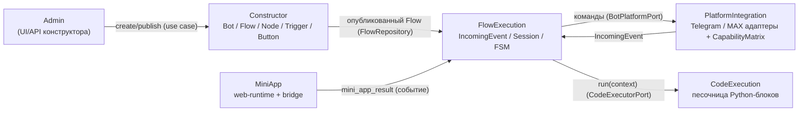

# Ограниченные контексты meta-bot-core

Карта контекстов: кто за что отвечает, как они общаются и чего им знать
**запрещено**. Контекст = граница применимости языка из [glossary.md](glossary.md):
один термин в разных контекстах может значить разное — это нормально и
фиксируется в глоссарии отдельными строками (колонка «Контекст»).

Главный инвариант проекта: **ядро (Constructor + FlowExecution) не знает, что
такое Telegram или MAX.** Платформенные различия живут только в PlatformIntegration
за портом `BotPlatformPort` и в `CapabilityMatrix`. Слои и поток зависимостей —
[../architecture/overview.md](../architecture/overview.md), правила поведения —
[business-rules.md](business-rules.md).

## Контексты

Контексты — логические границы внутри слоёной кодовой базы (модульный монолит),
а не микросервисы. Исключения выделены в отдельные исполняемые единицы: MiniApp —
отдельный web-продукт (TypeScript), CodeExecution — изолированный executor
(отдельный воркер/контейнер-песочница).

| Контекст | Ответственность | Модуль в коде | Владелец |
|---|---|---|---|
| Constructor | Сборка и валидация сценария: `Bot`, `Flow`, `Node`, `Trigger`, `Button`, `MiniApp`; публикация бота (BR-001, BR-006). **Не исполняет** сценарий | `src/domain/`, `src/application/` | уточнить у команды |
| FlowExecution | Исполнение сценария на входящих событиях: `IncomingEvent`, `Session`, FSM; `ProcessUpdateUseCase`, `RunFlowUseCase`, `ExecuteNodeUseCase`, `SendMessageUseCase` | `src/domain/`, `src/application/` | уточнить у команды |
| PlatformIntegration | Адаптеры платформ (`TelegramBotAdapter`, `MaxBotAdapter`) + `CapabilityMatrix`: парсинг update → `IncomingEvent`, отправка команд, `PlatformFactory` | `src/infrastructure/platforms/` | уточнить у команды |
| MiniApp | Web-runtime mini app: детект платформы, platform bridge, валидация init data (BR-007), возврат результата в backend | `mini-app/` | уточнить у команды |
| CodeExecution | Песочница пользовательских Python-блоков (`CustomCodeBlock.run(context) -> dict`); изолирована (BR-004) | `src/infrastructure/code_executor/` | уточнить у команды |
| Admin (presentation) | UI/API конструктора: FastAPI-роуты создания бота, сценария, публикации; тонкий слой над use cases Constructor | `src/presentation/api/admin_routes.py` | уточнить у команды |

Constructor и FlowExecution делят слои `domain`/`application`, но разведены по
языку и ответственности: один **собирает** граф, другой его **исполняет**;
пересечения на уровне сущностей описаны в [domain-model.md](domain-model.md).

## Карта интеграций

Каждая связь между контекстами — явная: доменное событие, синхронный вызов use
case или порт. Неявных связей (прямой импорт чужих внутренних классов, чтение
чужих таблиц, `if platform == …` вне PlatformIntegration) быть не должно (BR-005).

| Откуда → Куда | Механизм | Контракт | Что передаётся |
|---|---|---|---|
| Admin → Constructor | Синхронный вызов use case | `CreateBotUseCase`, `PublishBotUseCase` | Платформа, ссылка на токен (в vault), граф сценария |
| Constructor → FlowExecution | Общая читаемая модель (опубликованный сценарий) | `FlowRepository` (`src/application/ports/flow_repository.py`) | `Flow` = граф `Node` + переходов + `Trigger` + `Button` |
| PlatformIntegration → FlowExecution | Синхронный вызов use case | `IncomingEvent` (`src/domain/bot/events.py`), `ProcessUpdateUseCase` | `platform`, `bot_id`, `external_user_id`, `external_chat_id`, `event_type`, `text?`, `payload?`, `raw?` |
| FlowExecution → PlatformIntegration | Вызов порта | `BotPlatformPort` (`src/application/ports/bot_platform.py`) | Команды: `send_message`, `show_buttons`, ответ на callback, кнопка mini app |
| FlowExecution → CodeExecution | Вызов порта | `CodeExecutorPort` (`src/application/ports/`) | `context: dict` → результат `run(context) -> dict` (в изоляции, BR-004) |
| MiniApp → FlowExecution (backend) | HTTPS-запрос → доменное событие | `IncomingEvent` c `event_type = mini_app_result` | Провалидированные init data (BR-007) + payload результата mini app |

Диаграмма интеграций:

## Что контексту знать запрещено

Запреты — главное содержимое этого файла: они защищают границы при рефакторингах
и проверяются import-linter'ом ([../../.importlinter](../../.importlinter)) в
CI-джобе `arch-lint` ([../../.github/workflows/arch-lint.yml](../../.github/workflows/arch-lint.yml)).
Направление зависимостей внутри слоёв — [../architecture/overview.md](../architecture/overview.md),
протокол починки протечки — [../../.claude/rules/clean-architecture.md](../../.claude/rules/clean-architecture.md).

| Контекст | Запрещено |
|---|---|
| Constructor | Исполнять сценарий: нет FSM, `Session`, обработки `IncomingEvent`; не обращается к платформенным SDK. Только сборка и валидация графа |
| FlowExecution | Знать про специфику Telegram/MAX: оперирует только `IncomingEvent` и `BotPlatformPort`; никаких `if platform == …`, парсинга update и платформенных полей (BR-005) |
| PlatformIntegration | Содержать бизнес-логику сценария (ветвления `Flow`, работа с `Session`/FSM); только маппинг команд ↔ update, парсинг события и `CapabilityMatrix` |
| MiniApp | Доверять init data без backend-валидации (BR-007); исполнять сценарий; общаться с ядром иначе как через backend-контракт (событие `mini_app_result`) |
| CodeExecution | Доступ к БД, токенам, ФС, `env`, сети (кроме whitelist); импорт `domain`/`application`/`infrastructure`; побочные эффекты вне возвращаемого `dict` (BR-004) |
| Admin (presentation) | Бизнес-логика; доступ к БД/адаптерам в обход `application` — ходит только через use cases Constructor |

## Чек-лист при изменении границ

- [ ] Новый контекст добавлен во все три таблицы и на карту?
- [ ] Для каждой новой связи указан контракт (порт, событие или use case)?
- [ ] Не появился ли прямой импорт внутренних классов чужого контекста или
      `if platform == …` вне `infrastructure/platforms/`? (Подтверждено `lint-imports`.)
- [ ] Перенос сущности между контекстами отражён в
      [domain-model.md](domain-model.md) и [glossary.md](glossary.md)?
- [ ] Решение о выделении/слиянии контекстов оформлено как ADR
      ([../decisions/README.md](../decisions/README.md); связанные —
      [0002-domain-core-and-adapters](../decisions/0002-domain-core-and-adapters.md),
      [0005-capability-matrix](../decisions/0005-capability-matrix.md),
      [0006-mini-app-as-web-product](../decisions/0006-mini-app-as-web-product.md))?
