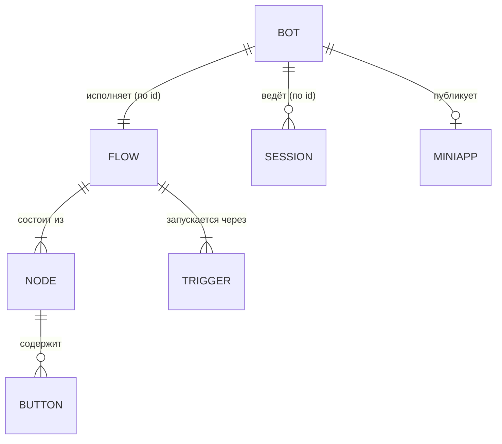
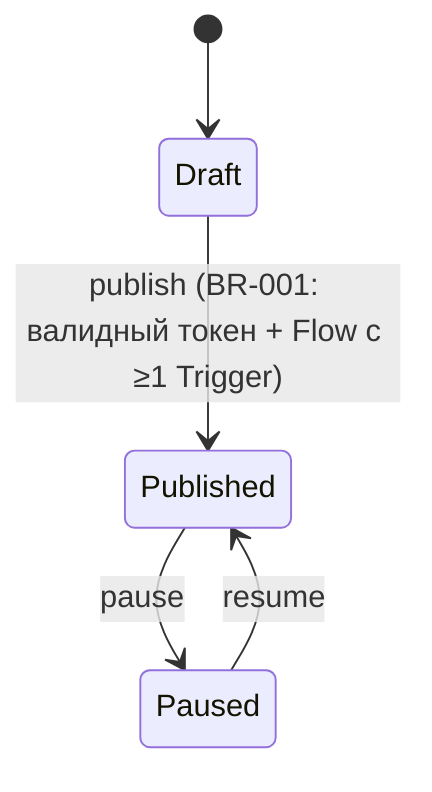

# Доменная модель meta-bot-core

Сущности, агрегаты и их инварианты. Имена — строго из [glossary.md](glossary.md).
Где эти классы лежат по слоям — [../architecture/overview.md](../architecture/overview.md);
принятые тактические паттерны (Entity, Value Object, Repository) —
[../architecture/patterns.md](../architecture/patterns.md).

Ядро конструктора платформонезависимо: оно оперирует сценарием (`Flow`), шагами
(`Node`), кнопками (`Button`) и состоянием пользователя (`Session`), а не знает про
Telegram или MAX. Три корня агрегата: **Bot**, **Flow**, **Session**. Между ними —
ссылки только по идентификатору; специфика платформ вынесена в адаптеры и
`CapabilityMatrix` (см. [bounded-contexts.md](bounded-contexts.md)).

## Сущности и агрегаты

Колонка «Где в коде» — путь к модулю/классу в репозитории; проверяется при сверке
с кодом (`verified_commit`, см. [../_meta/lifecycle.md](../_meta/lifecycle.md)).

| Сущность | Роль | Назначение | Ключевые инварианты | Где в коде |
|---|---|---|---|---|
| Bot | Корень агрегата | Подключённый платформенный бот: платформа + токен + ссылка на сценарий; конструктор управляет поведением уже зарегистрированного бота, а не создаёт его аккаунт | Ровно одна `Platform`; публикуется только при валидном токене зарегистрированного бота и непустом `Flow` с ≥1 `Trigger` (BR-001); ссылки на `Flow`/`Session` — по идентификатору | `src/domain/bot/entities.py::Bot` |
| Platform | Value object в агрегате Bot | Мессенджер бота: `telegram` \| `max` (расширяемо: VK, WhatsApp) | Значение из закрытого перечня; неизменяемо после создания бота | `src/domain/bot/value_objects.py::Platform` |
| Token | Value object в агрегате Bot | Секрет платформенного бота, связывающий его с конструктором | Секрет живёт только в token vault; в БД и логах — не в открытом виде; валидность проверяется при публикации (BR-001) | `src/domain/bot/value_objects.py::Token` |
| MiniApp | Внутри агрегата Bot | Web-приложение, привязанное к боту, запускается из кнопки | URL — только HTTPS; в MAX не существует без чат-бота (BR-003); init data валидируется на backend до доверия пользователю (BR-007) | `src/domain/bot/entities.py::MiniApp` |
| Flow | Корень агрегата | Сценарий = граф `Node` + переходов + `Trigger`; описывает поведение бота | ≥1 входной `Trigger`; каждый переход ведёт в существующий `Node`; каждый `Node` достижим от `Trigger`; нет висячих переходов; блоки допустимы на платформе бота (BR-006) | `src/domain/flow/entities.py::Flow` |
| Node | Внутри агрегата Flow | Шаг сценария: `send_message` \| `show_buttons` \| `ask` \| `condition` \| `open_mini_app` \| `save` \| `http_request` \| `notify` \| `custom_code` (спецификация каждого — [flow-blocks.md](flow-blocks.md)) | Тип доступен на платформе(ах) бота по `CapabilityMatrix` (BR-006); переходы — только к существующим `Node` того же `Flow` | `src/domain/flow/entities.py::Node` |
| Trigger | Внутри агрегата Flow | Вход в сценарий/ветку: `/start` \| `text` \| `callback` \| `mini_app_result` | У `Flow` есть хотя бы один входной `Trigger` (условие публикации, BR-001) | `src/domain/flow/entities.py::Trigger` |
| Button | Внутри агрегата Flow (у `Node`) | Единая модель кнопки: подпись + действие `open_mini_app` \| `callback` \| `url` \| `next` | Действие ссылается на существующий `Node` / `MiniApp` / HTTPS-URL; в платформенное представление превращает адаптер, не домен | `src/domain/flow/entities.py::Button` |
| Session | Корень агрегата | FSM-состояние пользователя: текущий шаг сценария + его переменные | Ровно одна активная `Session` на пару (`Bot`, пользователь); ссылки на `Bot`/`Flow` — по идентификатору | `src/domain/session/entities.py::Session` |

`CapabilityMatrix` (реестр доступных на платформе возможностей) и доменные события
`IncomingEvent` / `ButtonClicked` / `MiniAppOpened` — не агрегаты; их роль и место в
слоях описаны в [glossary.md](glossary.md) и [../architecture/overview.md](../architecture/overview.md).

## Отношения

Связи `Bot 1—1 Flow` и `Bot 1—* Session` пересекают границы агрегатов — в коде это
ссылка по идентификатору, а не объектная. `Node`/`Trigger`/`Button` живут внутри
агрегата `Flow`; `MiniApp` — внутри агрегата `Bot`.

Жизненный цикл статусов агрегата `Bot`:

## Правила целостности

- Границы агрегата = граница транзакции: один агрегат (`Bot`, `Flow` или `Session`)
  изменяется в одной транзакции; между агрегатами — согласованность в конечном счёте
  (события/саги).
- Ссылки между агрегатами — только по идентификатору, не по объектной ссылке
  (`Bot` → `Flow`, `Bot` → `Session`).
- Инварианты агрегата проверяются внутри агрегата (домен-слой), а не в use case,
  контроллере или БД-триггере. Каждый инвариант из таблицы покрыт unit-тестом
  (см. [../architecture/testing-strategy.md](../architecture/testing-strategy.md));
  условие публикации `Bot` — `tests/unit/bot/test_bot_publish.py` (BR-001).
- Инвариант, который проще сформулировать как правило поведения
  («нельзя X после Y»), регистрируется в [business-rules.md](business-rules.md)
  и здесь упоминается по номеру: публикация только с валидным токеном и непустым
  `Flow` (BR-001), `MiniApp` только HTTPS и не автономно в MAX (BR-003), допустимость
  блока на платформе (BR-006), валидация init data mini app (BR-007).
- Домен не ветвится по платформе: различия платформ скрыты за `BotPlatformPort` и
  `CapabilityMatrix`, `if platform == …` вне `infrastructure/platforms/` запрещён
  (BR-005, [../architecture/overview.md](../architecture/overview.md)).

## Чек-лист при изменении модели

- [ ] Новая сущность есть в [glossary.md](glossary.md)? Имя в коде совпадает?
- [ ] Определён корень агрегата и что входит в его границу?
- [ ] Инварианты записаны в таблицу и покрыты тестами?
- [ ] Диаграммы выше обновлены?
- [ ] Затронуты границы контекстов ([bounded-contexts.md](bounded-contexts.md))?
      Если сущность «понадобилась» второму контексту — это сигнал к обсуждению,
      а не к прямому импорту.
- [ ] Существенное решение по модели (разбиение агрегата, смена границ) —
      оформлено как ADR ([../decisions/README.md](../decisions/README.md))?
